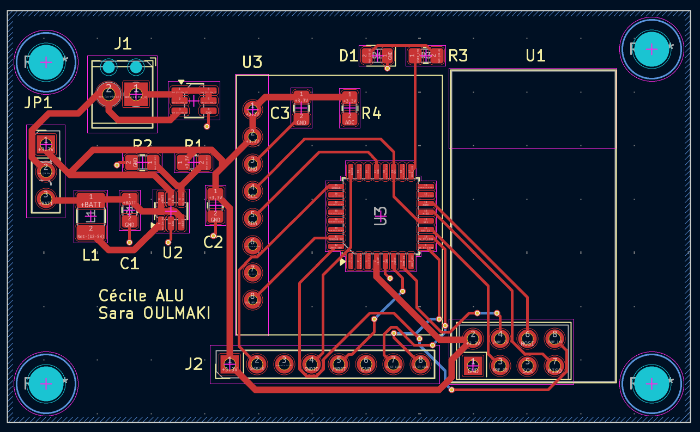
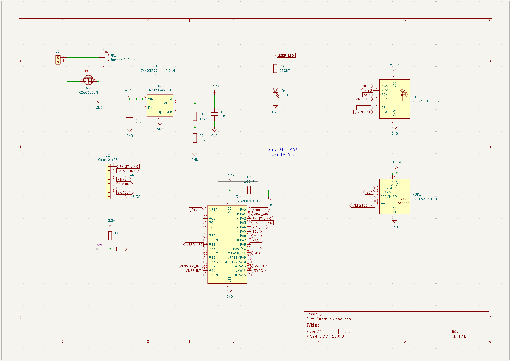
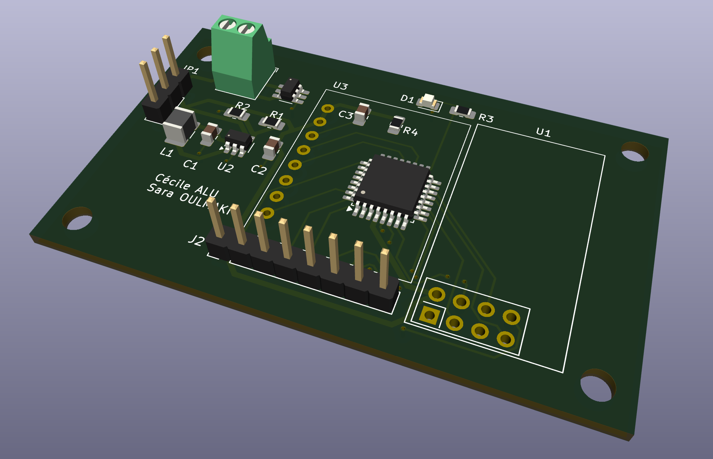

# Connected Air Quality Monitoring System

**Embedded air quality monitoring system integrating STM32 microcontrollers, wireless communication, MQTT, Qt/C++, SQLite, and custom PCB design.**

Academic project developed during the 2024–2025 academic year as part of the *Bachelor Universitaire de Technologie (BUT) in Electrical Engineering and Industrial Computing (GEII)* at IUT Montpellier, France.

## Project Overview

This project explores the design and development of a distributed air quality monitoring system, combining embedded electronics, wireless sensor communication, data processing, and desktop software.

The system was designed around several interconnected components:

- A custom sensor node PCB integrating an STM32G030 microcontroller and environmental sensors.
- An nRF24L01 wireless communication interface.
- An STM32-based gateway for receiving sensor data and forwarding information over a network using MQTT.
- A Qt/C++ application for serial data acquisition, AES decryption, and SQLite storage.
- A Qt graphical application for configuring the wireless communication system.

The project was developed across two academic semesters (S5 and S6), with different software and communication architectures explored throughout its development.

## System Architecture

The system combines embedded data acquisition, wireless communication, and software-based data processing.

### Sensor Node

The sensor node is based on a custom PCB designed using KiCad.

Its main components include:

- **STM32G030K8** microcontroller
- **ENS160** air quality sensor
- **AHT21** temperature and humidity sensor
- **nRF24L01** wireless transceiver
- Power supply and voltage regulation circuitry
- Programming and communication connectors

The STM32 communicates with the environmental sensors and provides the embedded processing capabilities required for data acquisition.

The nRF24L01 interface enables wireless communication with other parts of the system.

### STM32 Gateway

The gateway firmware targets the **STM32F439ZI** microcontroller and was developed using STM32CubeIDE.

Its architecture incorporates:

- **FreeRTOS** for task management
- **lwIP** for network communication
- **MQTT** for message transmission
- **SPI** communication with the nRF24L01 transceiver
- Custom application modules for wireless communication and MQTT handling

The gateway was intended to bridge wireless sensor communication with an IP-based network.

### Desktop Applications

Two Qt/C++ applications were developed during the project.

**Serial Data Receiver — Semester 5**

A console-based Qt application designed to receive data through a serial interface, process encrypted messages, and store information in an SQLite database.

Technologies and concepts:

- Qt Core and Qt Serial Port
- C/C++
- AES-128 decryption
- Serial communication
- SQLite database integration

**nRF24L01 Configurator — Semester 6**

A Qt Widgets graphical application developed to configure wireless communication parameters through a serial interface.

It includes functionality related to AES key configuration and communication with the connected embedded device.

Technologies and concepts:

- Qt Widgets
- Qt Designer
- Qt Serial Port
- C++17
- Serial communication and device configuration

## Hardware Design

The sensor node PCB was designed using **KiCad**, covering schematic capture, component placement, PCB routing, and 3D visualization.

The board integrates the microcontroller, sensor interfaces, wireless module connections, power circuitry, and programming interfaces.

### PCB Layout



### PCB Schematic



### 3D PCB Visualization



Additional hardware views and the original KiCad design files are available in the repository.

*Note: Some external modules do not have associated 3D models in the KiCad visualization.*

## Technologies Used

| Category | Technologies |
|---|---|
| Microcontrollers | STM32G030K8, STM32F439ZI |
| Programming | C, C++ |
| Embedded development | STM32CubeIDE, STM32CubeMX |
| Real-time systems | FreeRTOS |
| Wireless communication | nRF24L01, SPI |
| Networking | lwIP, MQTT |
| Desktop software | Qt, Qt Widgets, Qt Serial Port |
| Data processing | AES-128 |
| Database | SQLite |
| PCB design | KiCad |
| Development tools | Git, GitHub |

## Repository Structure

```text
connected-air-quality-monitoring/
├── hardware/
│   └── sensor-node-pcb/
│       ├── Capteur.kicad_pcb
│       ├── Capteur.kicad_sch
│       ├── Capteur.kicad_pro
│       └── Capteur.pdf
│
├── firmware/
│   └── s6-gateway-f439zi/
│       ├── Core/
│       ├── LWIP/
│       ├── userAppMqtt/
│       ├── userAppNrf/
│       ├── SAE_6_PASSERELLE.ioc
│       └── ...
│
├── software/
│   ├── s5-serial-to-sqlite/
│   │   ├── main.cpp
│   │   ├── serialportreader.cpp
│   │   ├── aes.c
│   │   ├── creaderasync.pro
│   │   └── ...
│   │
│   └── s6-nrf-configurator-gui/
│       ├── mainwindow.cpp
│       ├── mainwindow.ui
│       ├── serialportreader.cpp
│       ├── sae_6.pro
│       └── ...
│
├── docs/
│   └── images/
│
├── tools/
│   └── f303re-uart-led-test/
│
├── .gitignore
└── README.md
```

## My Contributions

This project was developed in a two-person team as part of my BUT GEII studies (2024–2025), in collaboration with **Cécile ALU**.

My contributions included:

- **PCB design and assembly:** Collaboratively designed the sensor node PCB using KiCad and personally soldered its electronic components.
- **Qt/C++ application development:** Independently developed the Qt applications for serial data acquisition, processing, and nRF24L01 configuration.
- **STM32 firmware development:** Worked alongside my project partner on embedded firmware development, with both of us contributing code and helping each other troubleshoot issues.
- **Hardware integration and testing:** Participated in debugging and testing, sharing the development hardware throughout the project.

The project combined individual software development with collaborative embedded systems engineering, from hardware design to firmware integration.

## Project Status and Limitations

**Status: Archived academic project (2024–2025).**

This repository preserves the available source files and design documents from the original project.

It is intended primarily as a technical portfolio and educational reference rather than a complete, ready-to-deploy system.

Important limitations include:

- Some original firmware components, including the STM32G030 sensor node firmware, are not available in this archive.
- The STM32F439ZI gateway source files are included, but certain external and third-party dependencies are not redistributed.
- The gateway may require additional libraries and project configuration before it can be compiled.
- Some modules reflect the original development state and may contain incomplete functionality or unresolved issues.
- Serial communication settings and application configuration may need to be adapted to the target hardware and operating system.
- The full end-to-end system has not been rebuilt or validated from the archived repository.

The source code is preserved to document the project's technical development rather than to represent a fully tested production implementation.

## Third-Party Components

The Qt serial receiver includes an AES implementation based on the open-source [tiny-AES-c](https://github.com/kokke/tiny-AES-c) project.

Its original public-domain dedication is included in:

`software/s5-serial-to-sqlite/UNLICENSE-tiny-AES-c.txt`

Additional third-party libraries used during the original embedded development are not necessarily included in this repository.

The presence of source code in this archive does not imply that all components were developed from scratch.

## Acknowledgements

Developed at **IUT Montpellier**, as part of the BUT GEII academic curriculum.

Special thanks to my project partner for the collaborative hardware and embedded firmware development.

---

**Sara OULMAKI**  
Embedded Systems & Electronics Engineering Student  
[GitHub](https://github.com/saraoulmaki)